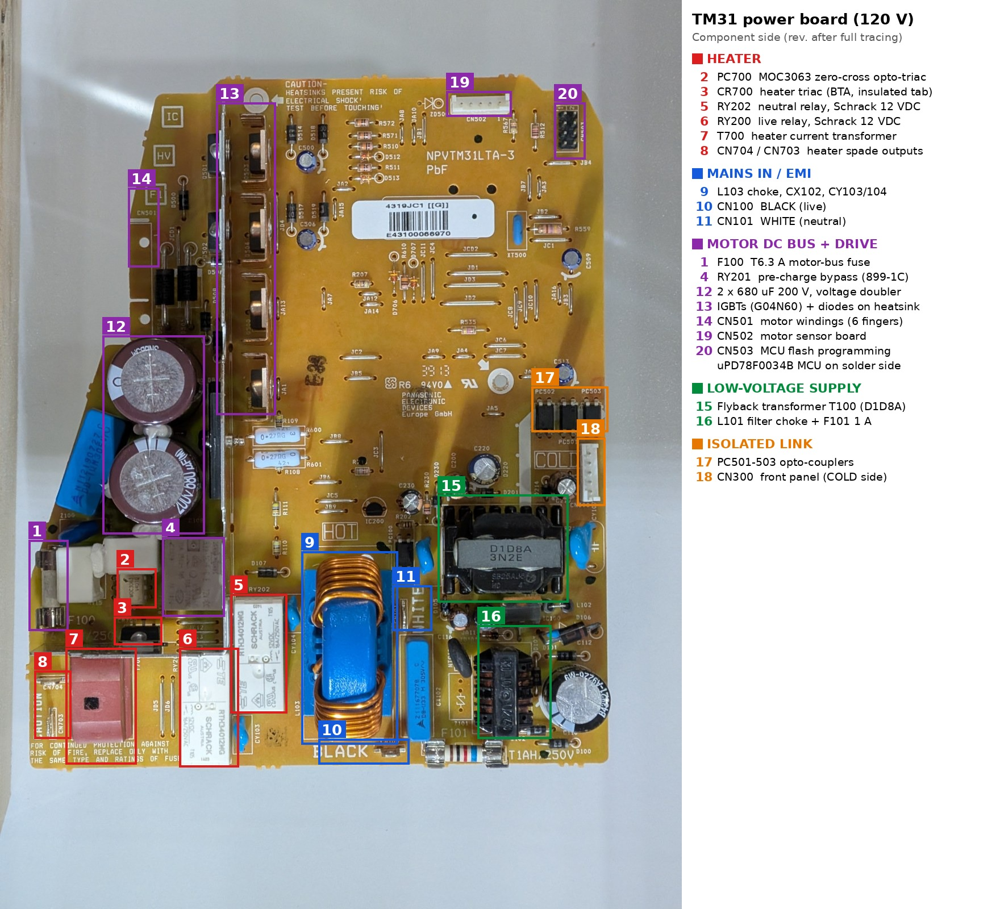

# Thermomix TM31 (120 V) power board — repair log & reverse engineering

Documentation of a **Vorwerk Thermomix TM31-4C (North American, 110–127 V)** that stopped heating, the repair, and a
near-complete reverse-engineering of its power board **NPVTM31LTA-3** (made by Panasonic Electronic Devices Europe).

Vorwerk ended spare parts and repairs for the TM31 at the end of 2024, so these machines now live or die by
owner repairs. Everything here was traced by continuity tests and measurements on a working board, with photos,
so others can diagnose their own machine.

> [!WARNING]
> **This board runs at mains potential everywhere except the small "COLD" corner around CN300.**
> - The ground of the whole board (MCU, op-amps, gate drivers) is the **motor DC bus negative**, not neutral and not earth.
> - The heatsink/shield is tied to the **motor DC bus positive (~340 V DC)**.
> - The two 680 µF capacitors can stay charged long after unplugging. Discharge and measure before touching.
> - Only use a **floating** multimeter on the hot side. Never clip a mains-earthed scope or a USB adapter to it.
> - You work on mains appliances at your own risk. Nothing here is endorsed by Vorwerk.

## The original fault, in one paragraph

**Symptom:** no heating and no error code. Temperature display, buttons and motor all worked.
**Cause:** the **A1 leg of the heater triac CR700 had cracked inside its C-shaped strain-relief bend** (metal fatigue
from motor vibration and heat cycling). The solder joint looked fine; continuity existed below the crack but not
between the leg near the triac body and its pad.
**Fix:** leg re-soldered, triac replacement with a **BTA24-600BW** (insulated-tab BTA, never a BTB). Re-form the C-bend
on the new part.
**Gotcha:** the TM31 only heats while a **time is set and the blade is turning**. Forgetting that during testing
looks exactly like the original fault.
Full story: [docs/01-repair-log.md](docs/01-repair-log.md).

## What's in this repository

| Path | Contents |
|---|---|
| [docs/01-repair-log.md](docs/01-repair-log.md) | Chronological log: symptom, hypotheses, tests, root cause, fix |
| [docs/02-architecture.md](docs/02-architecture.md) | How the board works, block diagram, annotated photo maps |
| [docs/03-heater-circuit.md](docs/03-heater-circuit.md) | Mains input, relays, heater path, triac firing |
| [docs/04-motor-dc-bus.md](docs/04-motor-dc-bus.md) | Voltage doubler, pre-charge, bypass relay |
| [docs/05-motor-drive.md](docs/05-motor-drive.md) | 4-phase switched-reluctance drive, IGBTs, drivers, overcurrent cut-off |
| [docs/06-safety-logic.md](docs/06-safety-logic.md) | Relay permits, hardware watchdog, gate-drive enable, fault latch |
| [docs/07-analog-sensing.md](docs/07-analog-sensing.md) | Heater/motor current sensing, comparators, motor sensor board |
| [docs/08-mcu-and-links.md](docs/08-mcu-and-links.md) | MCU pin map, programming header, front-panel link |
| [docs/09-power-supply.md](docs/09-power-supply.md) | Low-voltage flyback supply and its rails |
| [docs/10-parts-list.md](docs/10-parts-list.md) | Every identified part: marking, value, function, confidence |
| [docs/11-connectors-and-wiring.md](docs/11-connectors-and-wiring.md) | Connector pinouts and machine wiring diagram |
| [docs/12-measurements.md](docs/12-measurements.md) | All measured values (resistances, diode drops, bowl, motor) |
| [docs/13-unknowns-and-hypotheses.md](docs/13-unknowns-and-hypotheses.md) | What is confirmed, inferred, or still unknown |
| [docs/14-troubleshooting.md](docs/14-troubleshooting.md) | Symptom → what to check, with safe test procedures |
| [docs/15-future-work.md](docs/15-future-work.md) | Next steps (decoding the front-panel serial link) |
| [docs/16-references.md](docs/16-references.md) | Forum threads, service documents, sources |
| [datasheets/](datasheets/README.md) | Datasheet links for every identified chip and power part; archived MCU datasheet |
| [hardware/](hardware/README.md) | KiCad schematic project (8 wired sheets), PDF and netlist |
| [images/annotated/](images/annotated) | Annotated maps of both board sides |
| [images/diagrams/](images/diagrams) | Rendered block, safety-logic and wiring diagrams (PNG copies of the Mermaid diagrams) |
| [photos/](photos) | Original photos (resized, metadata stripped) |
| [tools/](tools/README.md) | Scripts that generate the schematic, the annotated images and the website |
| [website/](website/README.md) | Configuration of the documentation website (static, self-hostable, works offline) |

## Key findings at a glance

- **Two relays break both mains wires**: RY200 (live) and RY202 (neutral). They feed the heater (triac + current
  transformer) and the motor DC bus.
- **The motor bus is a voltage doubler** on the 120 V board (~340 V DC, same as a 230 V bridge), pre-charged through
  R115 (6.8 Ω with a 139 °C thermal fuse) + R114 (15 Ω), then bypassed by RY201. **F100 (T6.3 A) is the motor fuse**,
  not part of the heater path.
- **The power board has its own MCU**, an NEC/Renesas µPD78F0034B, driving a **4-phase switched-reluctance motor**
  (8 stator poles, 6 IGBTs, two shared high-side switches).
- **Layered hardware safety**: both mains relays and the IGBT gate-drive supply require two open-drain MCU permits,
  which only a latching fault comparator (IC700) can hold high, plus a running 74HC123 hardware watchdog. RY202 also
  needs the front panel's enable signal. A comparator cuts the high-side IGBTs on motor overcurrent without firmware.
- **The front panel talks to the power board over an opto-isolated UART** on CN300, the only isolated connector.
- **120 V bowl:** heater 12.8 Ω (about 1.1 kW, 9.4 A), NTC about 130 kΩ at room temperature.
  The service guide's "sensor 48–55 Ω / heater 110–130 kΩ" values are swapped labels for a 230 V bowl.

## Website

Everything here is also available as a browsable website with search, photo galleries and a schematic viewer.
It is plain static files: GitHub Pages builds it from this repository, and it can be hosted on any web server or
opened straight from disk. See [website/README.md](website/README.md).

## Status

- The machine is repaired and heats normally.
- Power board: about 95 % traced. Open items are listed in
  [docs/13-unknowns-and-hypotheses.md](docs/13-unknowns-and-hypotheses.md).
- Schematic: rev 0.2, drawn as wired circuits, KiCad 7 format (opens in KiCad 8–10). Connections verified identical
  to the rev 0.1 netlist.

Corrections, photos of other board revisions (230 V, pre-2012) and measurements are welcome. Open an issue or a pull
request.

## License and credits

Documentation, photos, drawings and schematic: [CC BY-SA 4.0](LICENSE). Scripts in `tools/`: same license.
Datasheets remain the property of their manufacturers and are not covered by that license. Most are linked; the
discontinued MCU's datasheet is archived unmodified in [`datasheets/archive/`](datasheets/archive/NOTICE.md).

Traced, measured and photographed by Julien, with analysis and documentation assistance from Claude (Anthropic).
"Thermomix" and "Vorwerk" are trademarks of Vorwerk; this project is not affiliated with Vorwerk.
