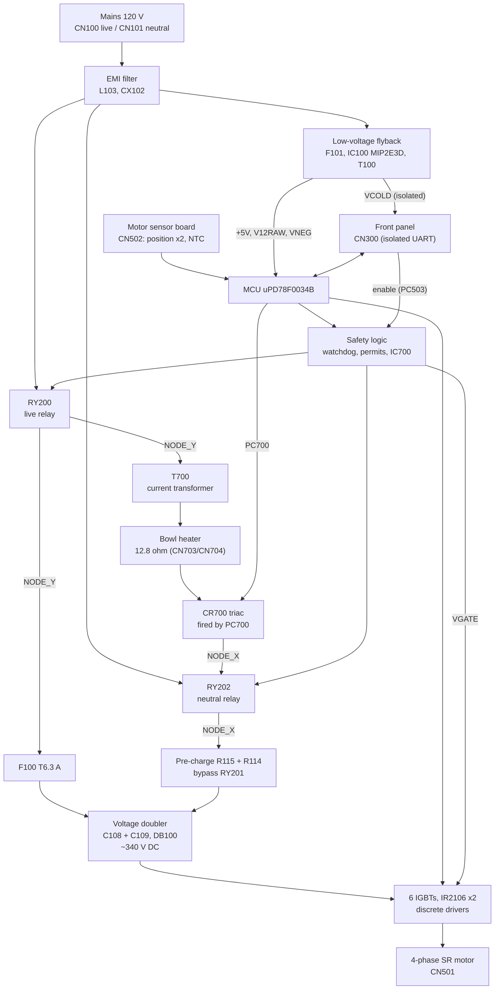

# 02 — Board architecture

The TM31 has two main boards:

- **Front control panel** (display, keys, speed knob). It reads the bowl temperature sensor and, as far as we know,
  the scale and lid sensors.
- **Power board NPVTM31LTA-3** (this repository). It switches mains to the heater, generates the motor DC bus, drives
  the motor with its own microcontroller, and enforces hardware safety interlocks.

The two boards talk over an **opto-isolated serial link** (CN300, blue cable). CN300 is the only isolated
("COLD") point of the power board.

## Block diagram

## Ground domains

| Domain | Reference | Contents |
|---|---|---|
| Mains | L / N | EMI filter, relays' contacts, heater, triac, pre-charge |
| **Hot logic** | **GND = motor DC bus negative** | MCU, IR2106 COM, op-amps, comparators, watchdog, relay coils, +5 V, V12RAW, VNEG |
| Motor bus | GND to VBUS (~340 V) | Capacitors, IGBTs, freewheel diodes. **Heatsink = VBUS** |
| SMPS primary | its own bridge (D100–D103) | IC100, T100 primary |
| **Cold (isolated)** | GND_COLD | CN300, the cold side of PC501–PC503, VCOLD from a T100 winding |

Why the hot logic sits on the bus negative: the low-side IGBT gate drivers must share the emitters' reference.
Consequences:
- the triac needs an opto-triac (PC700), because it sits on mains;
- the heater current is sensed through a current transformer (T700);
- the front-panel link needs optocouplers.

## Power-up sequence (the 3 relay clicks)

1. The flyback supply starts directly from mains and powers the MCU (relays still open).
2. The MCU starts pulsing the hardware watchdog (IC503). IC700 raises the permits. The front panel enables PC503.
3. **RY200 and RY202 close** (live and neutral). The bus capacitors charge through R115 + R114.
4. The MCU checks the charging voltage through RY201's normally-closed contact → D107 → MCU pin 33.
5. **RY201 switches over**, shorting the pre-charge resistors.
6. Gate-drive supply VGATE is present (Q205/Q206) as long as both relay permits stay valid.
7. Heating = PC700 firing the triac (zero-cross), only while a time is set and the motor runs.

## Annotated photos

| Image | Shows |
|---|---|
| [Component side](../images/annotated/component-side-block-map.jpg) | Functional blocks, relays, heater parts, supply |
| [Solder side, quadrant A](../images/annotated/solder-side-quadrant-A-cold-side-and-supply.jpg) | Cold zone, CN300, optos, flyback, mains input |
| [Solder side, quadrant B](../images/annotated/solder-side-quadrant-B-mcu.jpg) | MCU, CN502, CN503, watchdog, op-amps |
| [Solder side, quadrant C](../images/annotated/solder-side-quadrant-C-motor-drive.jpg) | IR2106 drivers, IGBT legs, CN501, DB100, shunts |
| [Solder side, quadrant D](../images/annotated/solder-side-quadrant-D-heater-and-power.jpg) | Heater path, relays, T700, pre-charge, doubler |

The board has **one copper layer** (bottom). The top side uses wire jumpers (JA*, JB*, JC*, JD*), and all SMD parts
are on the solder side. The heavy black ink bar across the solder side is not an isolation boundary (traces pass
under it); the black outline around CN300 and the optocouplers is the isolation boundary.

## Board revisions

The Vorwerk service procedure lists two power board references: **30915** (2004 to week 51 of 2012) and **30468**
(from week 51 of 2012). They must match the control board revision (32008 or 30466), otherwise error 61 and scale
calibration problems. This board's parts carry 2014 date codes, so it is probably the later revision.
That has not been verified against a label.
