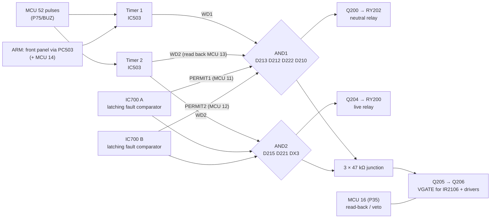

# 06 — Safety logic: relay permits, hardware watchdog, gate-drive enable

Schematic sheet: **Safety logic**. Status: structure **confirmed by continuity**; IC700's input network
**partly traced**.

This is the most interesting part of the board. Mains (both poles) and the IGBT gate drive are only enabled while
several **independent** conditions hold, so a single stuck pin, a crashed firmware or a dead detector cannot leave the
heater or motor powered.

## Overview



## Key fact: open-drain MCU pins

From the µPD78F0034 datasheet (p. 11), **P30–P33 (MCU pins 11–14) are N-channel open-drain**: they can pull a line
low or read it, but never drive it high.

| MCU pin | Port | Net | Role |
|---|---|---|---|
| 11 | P30 | PERMIT1 | Veto/read. **47 kΩ pull-down (R542)**. Held high only by IC700 output A through D707 |
| 12 | P31 | PERMIT2 | Veto/read. **47 kΩ pull-down (R706)**. Held high only by IC700 output B through D706 |
| 13 | P32 | WD2 | Watchdog timer 2 output (IC503 pin 5), read back / veto |
| 14 | P33 | ARM | Watchdog timer 1 arm input (IC503 pin 1), shared with PC503 (front panel) |

## Relay drivers (diode-AND gates)

In the sketch below, every AND diode has its **anode on the AND node** and its **cathode on the input**.

```
V12RAW ─[R206 47k]─ AND1 ─┬─|<─ D213 ─ WD1 (IC503 pin 13 via JC7)
                          ├─|<─ D212 ─ WD2 (IC503 pin 5 = MCU 13)
                          ├─|<─ D222 ─ PERMIT1 (MCU 11)
                          ├─|<─ D210 ─ PERMIT2 (MCU 12)
                          └── Q200 base;  Q200 collector ─ RY202 coil (D223 flyback) ─ V12RAW

V12RAW ─[47k]─ AND2 ─┬─|<─ D215 ─ WD2
                     ├─|<─ D221 ─ PERMIT1
                     ├─|<─ DX3 (unnumbered) ─ PERMIT2
                     └── Q204 base;  Q204 collector ─ RY200 coil (D224 flyback) ─ V12RAW

Q200 / Q204 emitters ─ D225 / D226 ─ GND (via JA9 / JA4)      raises the turn-on threshold to ~1.3 V
MCU 49 (P72) ─[base R]─ Q202 ;  Q202 collector ─ RY201 coil (D209 flyback) ─ V12RAW   (pre-charge bypass, not gated)
```

A relay can only close if **every** diode's cathode is high. Any one input pulled low drops the AND node.

- **RY202 (neutral)** needs: timer 1 alive (front panel + MCU), timer 2 alive, PERMIT1, PERMIT2.
- **RY200 (live)** needs: timer 2 alive, PERMIT1, PERMIT2.
- **RY201** is driven directly by MCU pin 49. It only bypasses the pre-charge resistors.

Relay coils (12 V): RY200 ~348 Ω, RY202 ~354 Ω, RY201 390 Ω. Common coil supply = V12RAW (C200 +, via JB9).

## Gate-driver supply enable (VGATE)

```
AND1 ─[47k]─┐
AND2 ─[47k]─┴─ EN_M ─[47k]─ Q205 base (also MCU 16 = P35, direct)
Q205 (NPN, emitter GND) collector ─[R213 6.2k]─ Q206 base ;  Q206 base ─[R212 470 Ω]─ emitter
Q206 (PNP) emitter = V12RAW ;  collector = VGATE ─ JA2 ─ IR2106 pin 1 (both), discrete drivers (JA7, JB5), IC611 supply
```

**The IGBT drivers are only powered while both relay AND gates are satisfied.** If either drops to ~0 V, the 3-resistor
junction falls below what Q205 needs. A firmware crash (watchdog stops) or a fault latch removes all gate drive,
whatever the motor outputs do. MCU 16 can additionally hold Q205 off or read its state.

## Hardware watchdog: IC503 = 74HC(T)123

Dual **retriggerable** monostable (marking read as "74H?123?", most likely 74HCT123D).

| Pin | Function | Connection |
|---|---|---|
| 1 | 1A (arm, active low) | ARM: PC503 output (front panel), MCU 14, pull-up (RX20, near R546/R547) |
| 2 | 1B (trigger) | WDCLK = MCU 52 (P75/BUZ) via JC6 |
| 3, 11, 16 | /1CLR, /2CLR, VCC | +5 V |
| 4, 12 | /1Q, /2Q | Not connected |
| 5 | 2Q | WD2 = MCU 13 (and D212, D215) |
| 6, 8, 9, 14 | 2Cx, GND, 2A, 1Cx | GND |
| 7 | 2Rx/Cx | 1 MΩ ("105") to +5 V; C514 to GND (value unknown) |
| 10 | 2B (trigger) | WDCLK |
| 13 | 1Q | WD1 via JC7 → D213, IC700 threshold divider |
| 15 | 1Rx/Cx | R548 (unreadable) to +5 V; C513 22 µF |

- **Timer 1** retriggers only while the MCU pulses pin 52 **and** ARM is low (front panel driving PC503). If the
  panel stops or is disconnected, or the MCU hangs, 1Q drops after ~0.45 × R548 × 22 µF and RY202 opens.
- **Timer 2** retriggers from the same pulses (2A tied low). Its output gates both relays and VGATE, and is read back by
  the MCU (a self-test of the watchdog chip). Time-out ≈ 0.45 × 1 MΩ × C514.
- Caveat: MCU 14 is open-drain on the ARM line. If the firmware drives it low itself, timer 1 could be armed without the
  panel. Whether the panel's veto is absolute depends on firmware.

## Latching fault comparators: IC700 = TLC277

```
IC700 out A ─|>|─ D707 ─ PERMIT1 (MCU 11)      IC700 out B ─|>|─ D706 ─ PERMIT2 (MCU 12)
latch: +IN A ─|>|─ D702 ─ out A               latch: +IN B ─|>|─ D703 ─ out B
−IN A: divider from WD1: 39 kΩ (from WD1) / 150 kΩ (to GND)   → ~4 V while the watchdog runs, 0 V when stopped
+IN A: R702 47 kΩ ← NODE_N
−IN B: RC from NODE_N (~470 kΩ, capacitor to GND)
+IN B: 39 kΩ to GND, 150 kΩ ∥ C from the "JC3" net (source not traced)
NODE_N: R702 47 kΩ, ~470 kΩ, R708 1 MΩ → D601 (cathode → 1.2 kΩ → GND; anode source not traced)
Supply: pin 8 = +5 V, pin 4 = GND
```

Interpretation (partly inferred):
- Each half holds its permit line **high while OK**. On a fault, the output goes low and **latches** through
  D702/D703, removing the permit. The relays and the gate-drive supply drop, and the MCU can read the cause on pins 11/12.
- Half A's threshold comes from the watchdog output, so the latch clears when the watchdog restarts (a power cycle in
  practice).
- A permit that must be actively held up fails safe: a dead or disconnected detector also removes it.
- Most likely monitored conditions: heater current while the triac should be off (shorted triac, error 69) and/or a
  current fault derived from IC611. **Not confirmed.**

## Diagnostics

| Symptom | Check |
|---|---|
| No relay clicks at all | V12RAW present? MCU running (pulses on pin 52)? Front panel connected (ARM)? IC700 outputs high? |
| Only RY201 clicks | AND gates: measure WD1, WD2, PERMIT1, PERMIT2 (all should be high), Q200/Q204 |
| Relays drop after a fault and only recover after unplugging | IC700 latch tripped. Look for the cause (heater current with triac off?) |
| Motor never runs but relays click | VGATE missing: Q205/Q206, EN_M network, MCU 16 |
