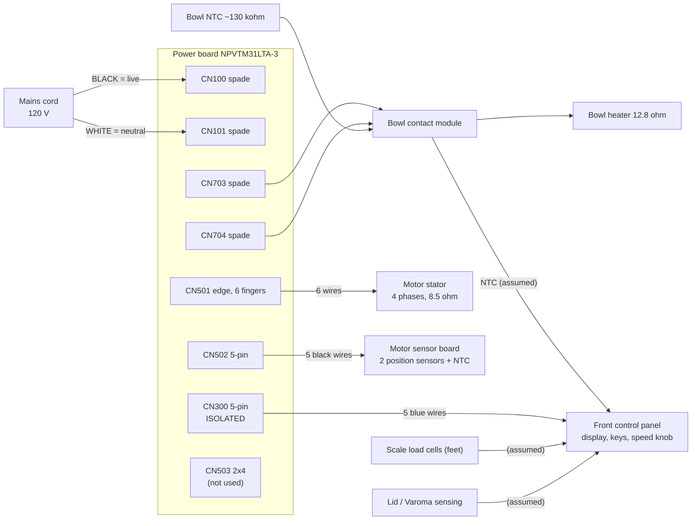

# 11 — Connectors and machine wiring

## Machine wiring diagram

Items marked *(assumed)* were not traced. The front panel and bowl contact module were not opened.

## Connector pinouts

### CN100 / CN101: mains input (spade tabs)
| Tab | Silkscreen | Signal |
|---|---|---|
| CN100 | BLACK | Live |
| CN101 | WHITE | Neutral |

### CN703 / CN704: heater (spade tabs)
| Tab | Net | Connected to |
|---|---|---|
| CN703 | HEAT_HI | T700 primary → NODE_Y → RY200 → live |
| CN704 | HEAT_LO | Triac CR700 A1 (A2 → NODE_X → RY202 → neutral) |

### CN501: motor (edge connector, 6 fingers, 5.5 mm pitch)
| Pin | Net | Switch | Phases |
|---|---|---|---|
| 1 | MOT1 | Q501 emitter (high side), D504 | shared end of 1–3 and 1–5 |
| 2 | MOT2 | Q502 emitter (high side), D505 | shared end of 2–4 and 2–6 |
| 3 | MOT3 | Q503 collector (low side), D500 | 1–3 |
| 4 | MOT4 | Q504 collector, D506 | 2–4 |
| 5 | MOT5 | Q500 collector, D508 | 1–5 |
| 6 | MOT6 | Q505 collector, D507 | 2–6 |

### CN502: motor sensor board (5 pins)
| Pin | Signal | MCU |
|---|---|---|
| 1 | Motor NTC (~12.5 kΩ room temp) | 31 (ANI2) via ~1 kΩ |
| 2 | Position sensor A | 44 (INTP1) via 20 kΩ |
| 3 | Position sensor B | 43 (INTP0) via 20 kΩ |
| 4 | Sensor supply (Q508/ZD500) | — |
| 5 | GND | 9 |

### CN300: front panel (5 pins, **isolated**)
| Pin | Signal |
|---|---|
| 1 | GND_COLD |
| 2 | Data panel → power board (→ MCU RxD0, pin 21) |
| 3 | VCOLD (supply to panel) |
| 4 | Data power board → panel (← MCU TxD0, pin 22) |
| 5 | Panel enable (PC503 → watchdog arm) |

### CN503: flash programming (2 × 4, unpopulated cable)
| Pin | Signal | Pin | Signal |
|---|---|---|---|
| 1 | GND | 2 | RESET |
| 3 | SO30 | 4 | +5 V |
| 5 | SI30 | 6 | VPP |
| 7 | SCK30 | 8 | n.c. |

## Wire jumpers worth knowing

| Jumper | Carries |
|---|---|
| JC12, JC13, JC14 | Heater current RY202 → NODE_X (three in parallel, over a signal bus) |
| JA2 | VGATE to IR2106 supply pins |
| JA7, JB5 | VGATE to the discrete driver pull-ups |
| JB9 | V12RAW (C200 +) to relay coils |
| JC6 | Watchdog pulses MCU 52 → IC503 pin 2 |
| JC7 | Watchdog timer 1 output → D213 and IC700 threshold |
| JC11 | IC610 trip output → D513 |
| JC15 | Pre-charge node (R115 / R114 / CX101) |
| JCD3 | Bus negative → D504/D505 anodes |
| JD1 | Pre-charge sense → MCU pin 33 |
| JD5, JD6 | T700 secondary → IC611 |
| JA9, JA4 | Ground returns of relay drivers (D225/D226) |
